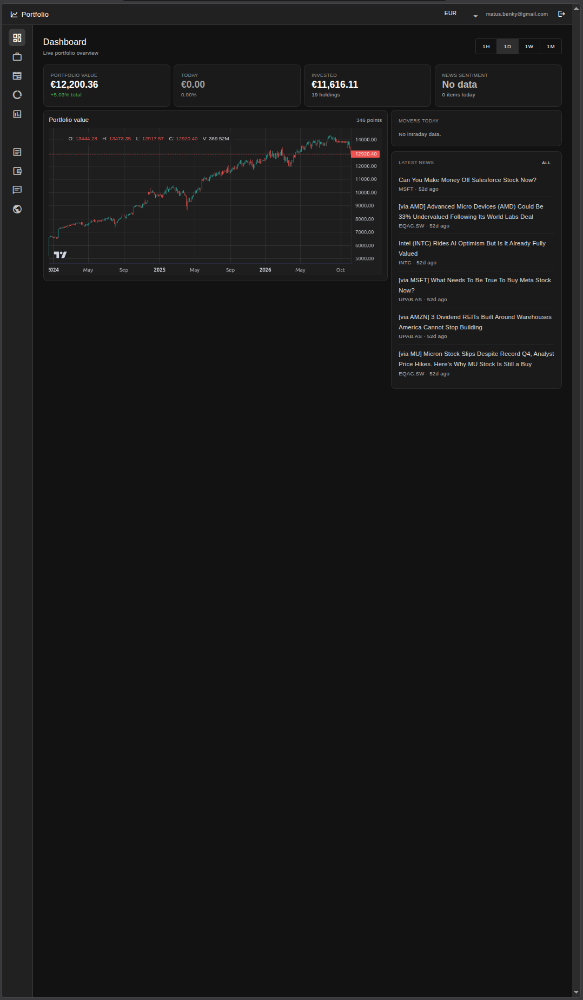
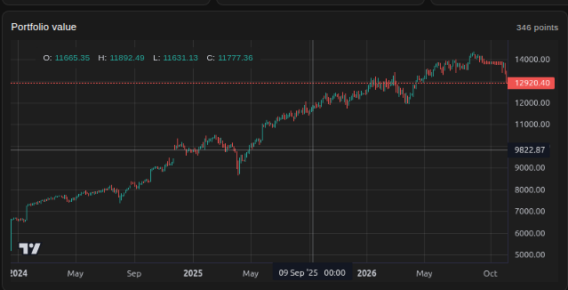
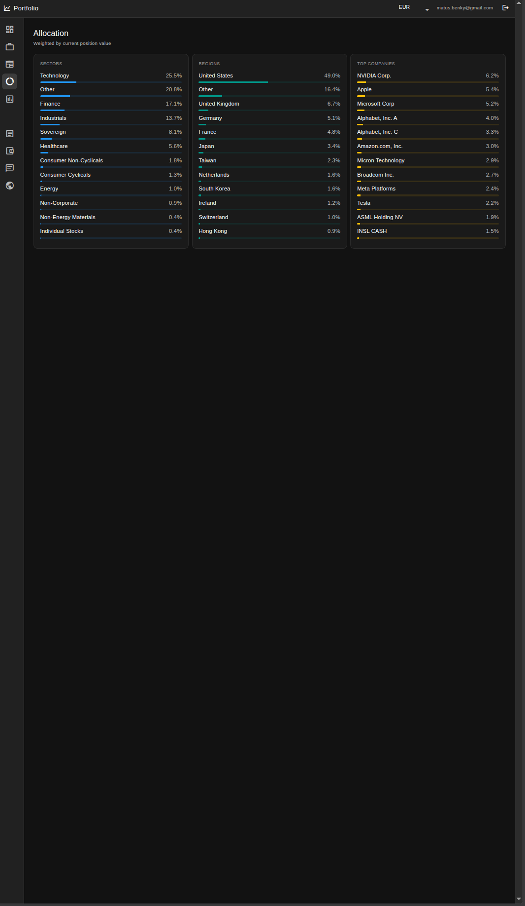
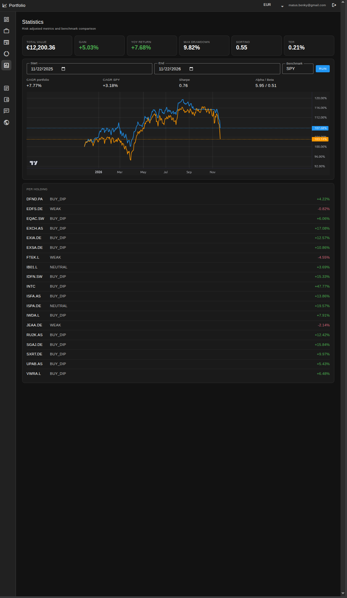
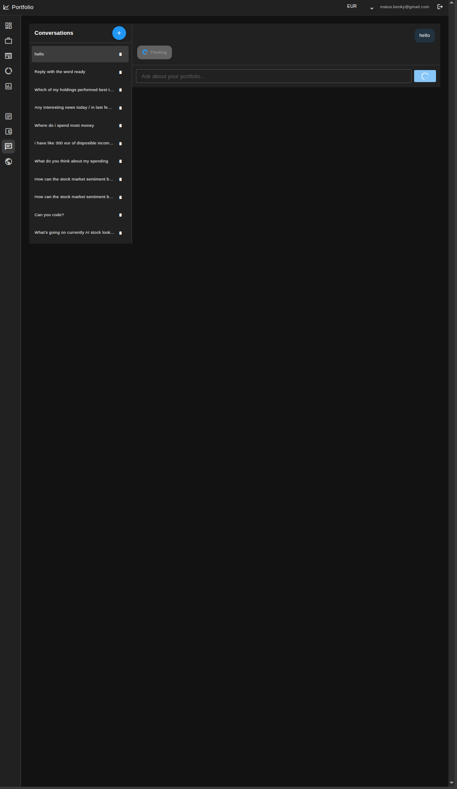
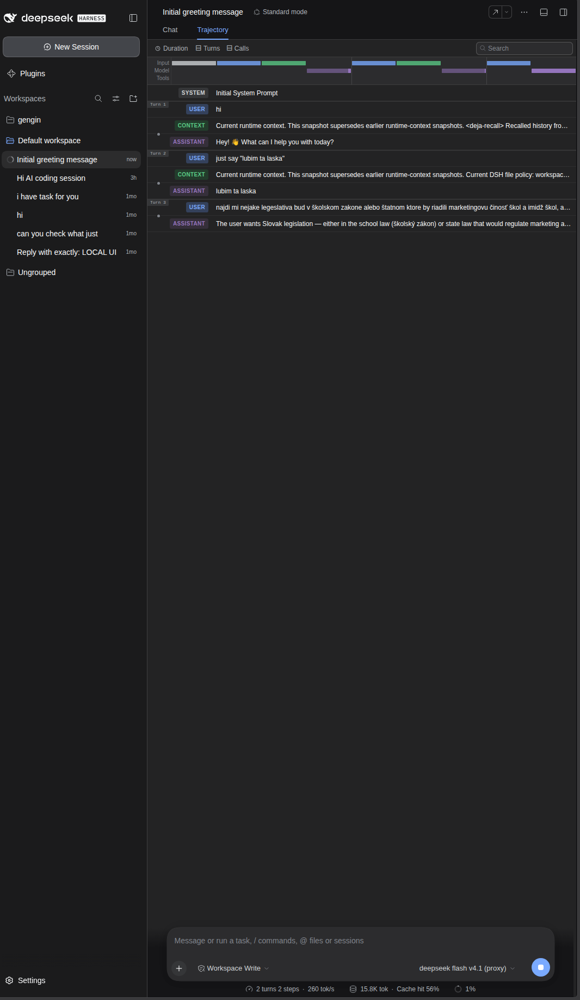
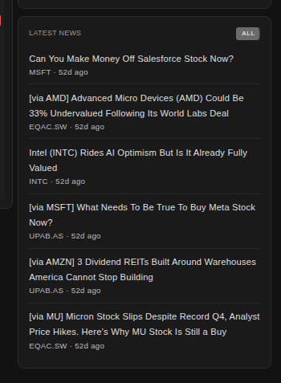
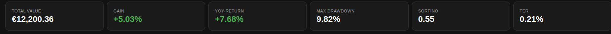

Your task is to create new branch for example named ```version2```

In this brench your task is to redesigne / rewrite whole code base

Goals:

1. Make codebase organized - separated to individual parts
2. Current code base feels like we bolted staff on staff so plan whole architecture
3. Code should be optimalized so test not olnly correctness of each api componets ... but also preformance
3.1 Test all components individually and then integrated together
4. It woudl be ideal if whole app woudld be just Golang so i dont need to run Vie js and go but if not possibe keep Go and Vue.js
5. Current project uses Llms your goal is to optimalize the use of them to reduce cost as much ass possible
6. Frontend of the aplication looks preaty good but i would make it more minimalistic keep the themes i like them
7. Follow styling and code instructions in ./github/copilot-instructions.md
8. You are autonomues so do all the changes dont ask qestious to the user
9. Avoid building to much boilerplate code base shoud be really lean
10. the VM that is running this application is having limited space so optimalize the resolution of saving the price charts
11. Do not remove any current functionality you can add functionalities if you judge them that it could improve user experience
12. chat experiance with llm feel lacking maybe use some harness to improve it like pi or dsh  ...

Note - i added to the .env new api key for open router with 2 dollars of credits this api key is for you to test and optimalize the costs of this app

13.  the home view seems to bee too empty
14. the site is optimalized for desktop not phone for example it is hard to open side bar and navigate on phone so optimalize it for phone
15.  chart are missing break even price it is not shown
16.  alocations are mising the pie charts showing the distributions i like them and over all it feels empty
17.  statistic tab feels empty and is missing lot of functionality compare with the old one
18.  it woud be nice to see the thinking not just spiner also see what was included in the prompt for example like this 
19. related to chatting switch the api to tencent/hy4-flash this model seems to be better comapre to current we can keep the current one for summaries if it is chepest
20. trading window where you choud explore individual stocks etfs ... and use indicators like MA or EMA POC TPO ... is missing
21. over all lot of exiting functionalities are missing from the old version and needs to be added
22. some views feel kinda empty add staff to make them less empty
23. i already said it but optimize it also for mobile
24. keep embedding for articles never remove articles and embedings add tab to explore this data you can oly commapct price data not articles\
25.  this button is doing nothing
26.  i liked this kind of bar in main view main view shoud contain staff that can halp you see on first view how is portfolio doing and also maybe staff related to how you are doing financlly
27. look into master / main branch and check if some functionalities are not missing

27. deploy this new updated version on vm http://91.98.145.193:5173/
28. try to exploited it and find any other security issues and fix them
29. evaluate if you solved each of the tasks above
